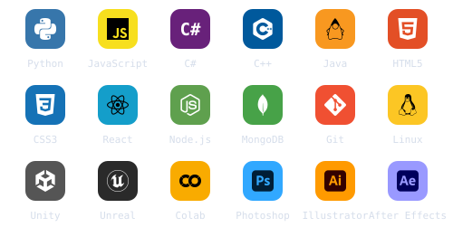

 

## `~/about`

Senior full-stack developer and graphic designer, currently deep in **AI** and convinced the next big shift in tech is still ahead of us.

- 🌱 Always a student — learning is the default state
- 🕯️ Most at home in a black IDE at 3 AM
- 👨🏻‍🏫 Teaching what I learn, writing about tech
- ❤️ Open source contributor
- 🧪 Random side projects are a lifestyle, not a phase

 

## `~/stack`

  

 

## `~/stats`

  
  
  
  
  
  

 

## `~/snake`

  <picture>
    <source media="(prefers-color-scheme: dark)" srcset="assets/snake-dark.svg">
    <source media="(prefers-color-scheme: light)" srcset="assets/snake.svg">
    
  </picture>

 

  Every widget here is generated from scratch by <a href="scripts/profile_cards.py">one small Python script</a> and refreshed daily by GitHub Actions — no third-party image services.

