

<picture><source media="(prefers-color-scheme: dark)" srcset="assets/hero-dark.svg"></picture>

 

🧑‍💻 <b>Senior full-stack developer</b> &amp; 🎨 <b>graphic designer</b> 
🤖 Deep into AI: LLMs, agents &amp; RAG 
✨ I build things that run well and look even better

🌱 Always learning &nbsp;·&nbsp; 👨‍🏫 Teaching &amp; writing &nbsp;·&nbsp; ❤️ Open source

 

<picture><source media="(prefers-color-scheme: dark)" srcset="assets/toolkit-languages-dark.svg"></picture>
<picture><source media="(prefers-color-scheme: dark)" srcset="assets/toolkit-apps-dark.svg"></picture>
<picture><source media="(prefers-color-scheme: dark)" srcset="assets/toolkit-ai-dark.svg">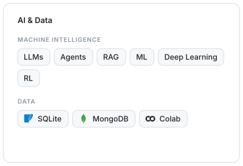</picture>
<picture><source media="(prefers-color-scheme: dark)" srcset="assets/toolkit-ops-dark.svg">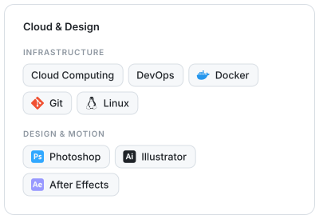</picture>

<picture><source media="(prefers-color-scheme: dark)" srcset="assets/overview-dark.svg"></picture>
<picture><source media="(prefers-color-scheme: dark)" srcset="assets/streak-dark.svg"></picture>
<picture><source media="(prefers-color-scheme: dark)" srcset="assets/activity-dark.svg"></picture>
<picture><source media="(prefers-color-scheme: dark)" srcset="assets/languages-dark.svg"></picture>
<picture><source media="(prefers-color-scheme: dark)" srcset="assets/weekly-dark.svg"></picture>
<picture><source media="(prefers-color-scheme: dark)" srcset="assets/monthly-dark.svg"></picture>

 

<picture><source media="(prefers-color-scheme: dark)" srcset="assets/snake-dark.svg"></picture>

