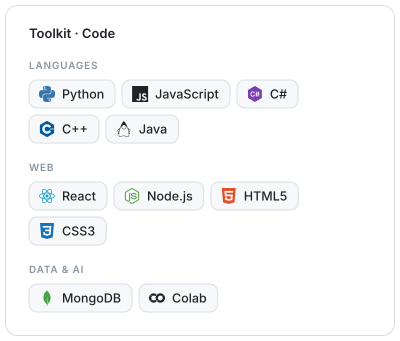
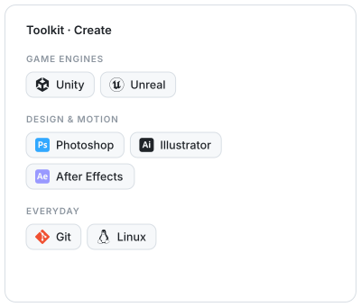

<picture><source media="(prefers-color-scheme: dark)" srcset="assets/hero-dark.svg"></picture>

 

Senior full-stack developer and graphic designer, currently deep in <b>AI</b>. 
I like building things that feel inevitable once they exist — and making them look good while I'm at it.

ALWAYS A STUDENT &nbsp;·&nbsp; 3 AM IN A DARK IDE &nbsp;·&nbsp; TEACHER &amp; TECH WRITER &nbsp;·&nbsp; OPEN SOURCE &nbsp;·&nbsp; CHRONIC SIDE-PROJECTER

 

<picture><source media="(prefers-color-scheme: dark)" srcset="assets/toolkit-code-dark.svg"></picture>
<picture><source media="(prefers-color-scheme: dark)" srcset="assets/toolkit-create-dark.svg"></picture>

<picture><source media="(prefers-color-scheme: dark)" srcset="assets/overview-dark.svg"></picture>
<picture><source media="(prefers-color-scheme: dark)" srcset="assets/streak-dark.svg"></picture>
<picture><source media="(prefers-color-scheme: dark)" srcset="assets/activity-dark.svg"></picture>
<picture><source media="(prefers-color-scheme: dark)" srcset="assets/languages-dark.svg"></picture>
<picture><source media="(prefers-color-scheme: dark)" srcset="assets/weekly-dark.svg"></picture>
<picture><source media="(prefers-color-scheme: dark)" srcset="assets/monthly-dark.svg"></picture>

 

<picture><source media="(prefers-color-scheme: dark)" srcset="assets/snake-dark.svg"></picture>

 

Every widget above is drawn by <a href="scripts/profile_cards.py">one small Python script</a> and refreshed daily by GitHub Actions.

